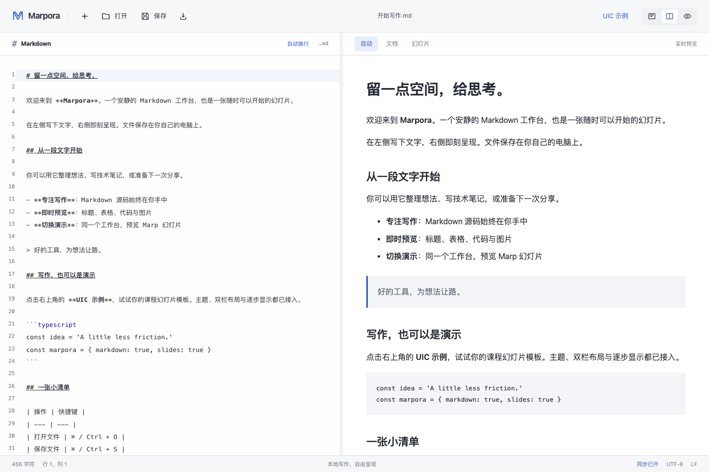
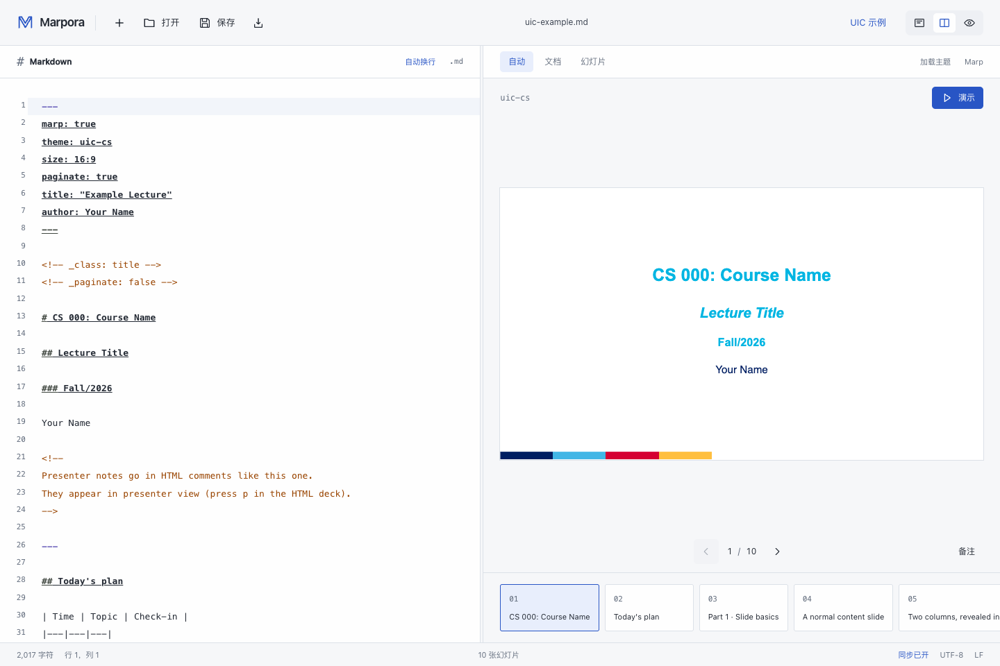

# Marpora

一个轻量、本地优先的 Markdown 与 Marp 桌面工作台。macOS 优先，使用 Tauri 2、Svelte 5、TypeScript、CodeMirror 6 和 Marp Core 5。



## 运行

需要 Node.js 24+、Rust stable，以及对应平台的 [Tauri 开发依赖](https://v2.tauri.app/start/prerequisites/)。macOS 需要 Xcode Command Line Tools。

```sh
npm ci
npm run desktop
```

浏览器开发模式：`npm run dev`，访问 `http://127.0.0.1:1420`。浏览器模式通过上传打开文件、通过下载保存文件；桌面模式使用系统文件对话框和原生保存。

## 当前原型

- Markdown 源码编辑、语法高亮、自动换行、查找替换、撤销重做。
- 文档实时预览、源码滚动同步；支持表格、代码、链接、HTML 与图片。
- 自动识别 front matter 中的 `marp: true`；也可以手动选择文档或幻灯片模式。
- Marp 幻灯片分页、导航、演讲者备注、演示模式与 fragment 逐步显示。
- 内置 UIC 主题和完整模板示例，支持 `<pause>` / `<enter>`、`<!-- hide -->`、`%%` 行注释。
- 加载自定义 Marp 主题 CSS；Marp 公式按需加载 KaTeX，数学字体在本地打包。
- 系统文件打开/保存/另存为、拖入 Markdown、快捷键、可调整双栏、单栏编辑或预览。
- 未保存提示与本机草稿恢复。原生保存采用临时文件替换，并在覆盖前检查外部修改，保留 UTF-8 BOM 和 LF/CRLF。

这是源码与预览双栏原型；Typora 式原位编辑、已有 HTML/PDF 文件查看、HTML/PDF 导出、文件树、多文档标签与 Finder 文件关联尚未实现。当前无云端服务或遥测。文档引用的远程图片或 CSS 资源仍可能发起网络请求。

## 验证你的 UIC 模板



点击工具栏 **UIC 示例**，或者通过 **打开** 选择：

```text
../../git/uic/slides/marp-uic-template/slides/example.md
```

十张示例幻灯片包含封面、分隔页、双栏、代码、逐步显示、iClicker 问题与答案页、表格和辅助样式。写作预览默认显示全部 fragment；点击 **演示** 后按空格或右方向键逐步显示，按 Esc 返回。演示是应用内的专注视图，可再使用系统窗口全屏按钮。

UIC CSS 与引擎来自 [marp-uic-slides-template](https://github.com/xjtuwxg/marp-uic-slides-template)，按 MIT 许可证保留在 `examples/uic`。内置副本增加编辑器源码位置映射，并修复所有幻灯片都隐藏时仍显示内容的问题；原始模板仓库没有修改。外部 JavaScript 引擎不会自动执行，原型仅加载内置的已知扩展。

加载其他主题时，CSS 需要有 `/* @theme name */`，并在 Markdown 中使用 `theme: name`。只支持已注册主题间的 `@import`；主题相对图片、字体资源需要可访问的 URL。

原生文档内的相对图片限定在文档目录及其子目录，禁止越界与符号链接逃逸。浏览器模式无法读取同目录其他文件。Markdown 以 UTF-8 处理；打开保存不会通过富文本 AST 重写源码。

## 快捷键

| 操作 | macOS | Windows / Linux |
| --- | --- | --- |
| 新建 | ⌘ N | Ctrl N |
| 打开 | ⌘ O | Ctrl O |
| 保存 | ⌘ S | Ctrl S |
| 另存为 | ⌘ Shift S | Ctrl Shift S |
| 查找 | ⌘ F | Ctrl F |
| 撤销 / 重做 | ⌘ Z / ⌘ Shift Z | Ctrl Z / Ctrl Shift Z |
| 演示翻页 / 逐步显示 | 方向键 / 空格 | 方向键 / 空格 |
| 退出演示 | Esc | Esc |

草稿保存在应用 WebView 的本地存储中，不会自动写回原文件；这是崩溃恢复辅助功能，正式保存仍使用 ⌘ / Ctrl S。

## 构建与检查

```sh
npm run check
npm test
npm run test:e2e
cargo test --manifest-path src-tauri/Cargo.toml --locked
npm run desktop:build -- --bundles app,dmg
```

浏览器测试在 macOS 上使用已安装的 Chrome；其他环境先运行 `npx playwright install chromium`。前端测试覆盖真实模板、双栏、fragment、隐藏页、行注释、源码映射和 HTML 清理；浏览器测试覆盖编辑、模板打开/保存往返、演示键盘、未保存保护、撤销隔离与草稿恢复。Rust 测试覆盖磁盘冲突、编码格式和资源路径权限。

macOS 产物在 `src-tauri/target/release/bundle/macos/` 和 `src-tauri/target/release/bundle/dmg/`。当前只在本机验证了 Apple Silicon macOS；本地包使用临时签名，尚未进行 Apple Developer ID 签名、公证或 Windows 签名。

`.github/workflows/packages.yml` 可手动运行或通过 `v*` 标签触发，为 Apple Silicon、Intel Mac、Windows x64 与 Linux x64 构建安装包并上传 workflow artifacts。它不会自动发布 GitHub Release。Windows/Linux 的实际构建和 WebView 行为需要在 CI 与对应系统上验证。

## 实现取舍

CodeMirror 中的文本是唯一真源，预览在 180 ms 停止输入后更新；Marp 和公式模块按需加载。应用不捆绑 Chromium 或 Node.js。预览 HTML 经清理后显示于禁用脚本的 iframe，文件权限留在原生主窗口。

目前渲染仍在前端主线程；大文档性能尚未基准测试，后续可以将 Marp 转换移入 Worker。预览区只渲染一张可见幻灯片，但整副牌的 DOM 会保留，适合当前轻量原型规模。
