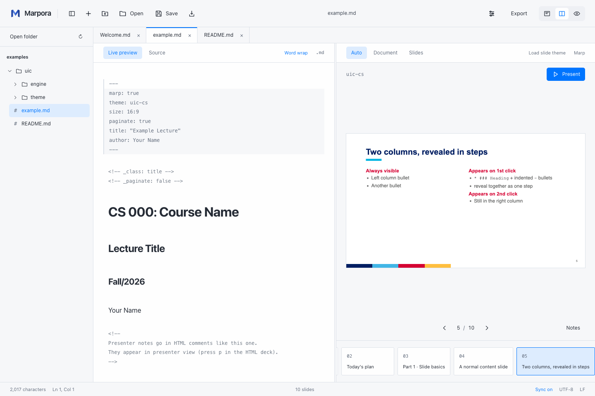
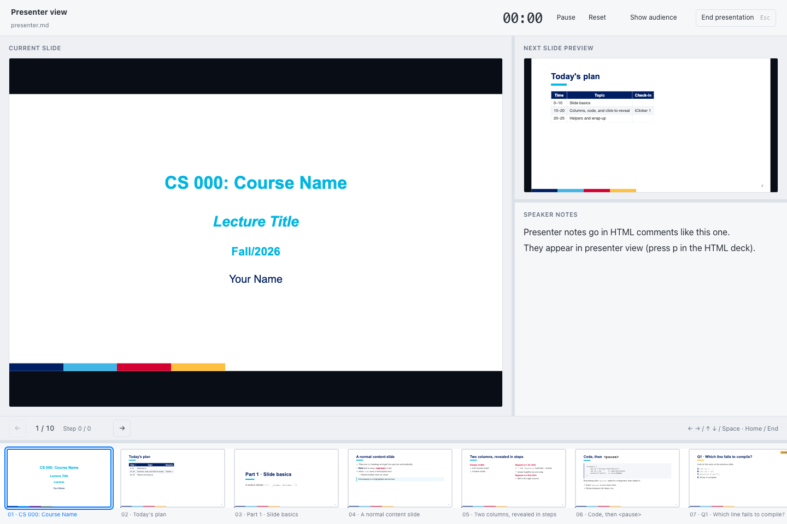

<p align="center"></p>
<h1 align="center">Marpora</h1>
<p align="center">Write locally. Present freely.</p>
<p align="center">A lightweight Markdown editor with live editing and Marp slides.<br>macOS first. Built with Tauri, Svelte, TypeScript and CodeMirror.</p>
<p align="center"><a href="https://github.com/marpora/marpora/releases/latest">Download for macOS</a> · <a href="README.zh-CN.md">简体中文</a> · <a href="#development">Development</a> · <a href="docs/architecture.md">Architecture</a> · <a href="brand/README.md">Brand assets</a></p>



Marpora is an early desktop prototype for writing Markdown and making presentations from the same plain-text files. It uses the system WebView and does **not bundle Chromium or Node.js**.

## What works

- **Live editing:** formatted headings, emphasis, links, lists and quotes. Click rendered code, tables or images to edit the original Markdown. Switch to source mode without losing selection or undo history.
- **Files and tabs:** open a folder, browse its nested Markdown / HTML / PDF files, and keep multiple documents open. Each Markdown tab retains its own text, undo history, selection and scroll position.
- **Dual-screen Presenter:** choose a projection display for fullscreen slides; the original window shows the current/next slide, private notes, a pauseable elapsed timer and resizable thumbnail navigation. Slides and fragments synchronize from either window.
- **Marp previews:** automatic `marp: true` detection, slide navigation, speaker notes, fragments, custom CSS themes and local KaTeX fonts.
- **HTML and PDF:** open exported Marp HTML as a script-free, read-only slide preview; read PDFs with page navigation and zoom. Export standalone HTML or PDF without changing the Markdown buffer.
- **English and Chinese:** English by default. Light, dark or system appearance; system, blue, teal, rose or amber accents.
- **Local documents:** UTF-8 BOM and LF/CRLF preservation, atomic disk saves, external-change checks, close warnings and recovery of multiple unsaved drafts.

Marp front matter, slide separators, comments and custom directives stay in the original source. Live editing never round-trips a rendered DOM or a rich-text AST back into Markdown.

## Try it

Open a Markdown file with **Open**, or choose **Open folder** to browse a workspace. Markdown opens in live editing; a Marp deck opens with a slide preview. The sidebar can be hidden while you write. Use **Export → HTML / PDF** for a copy of the current buffer, including unsaved edits. Exporting does not save the original document.

The [UIC fixture](examples/uic/example.md) exercises ten slides, custom layouts, comments, fragments, code, tables and notes. Open it through the same file picker as any other document. It is a compatibility fixture, not a dedicated product action. The MIT-licensed theme and known extension are attributed in [examples/uic](examples/uic); Marpora does not execute arbitrary external Marp JavaScript engines.

### Present on two screens

Open a Marp Markdown deck or exported Marp HTML, then choose **Present → Audience display → Start presentation**. Connect a projector for a fullscreen audience window; the original window becomes the presenter console. **Show audience** brings the projection window to the front. **Windowed rehearsal** works on one display. Browser development supports a separate rehearsal pop-up; display selection is available in the desktop app.

Use arrow keys, Page Up/Down or Space in either window to navigate slides and reveal fragments. Home/End jumps to the first/last slide; Esc ends the presentation. Click a thumbnail to jump to that slide with its fragments reset. The timer starts when the audience deck is ready, and supports Pause/Resume and Reset. Drag the column, notes or thumbnail dividers to resize; double-click to reset. Notes stay in the presenter window, including notes recovered from standard Marp HTML exports.

Presenting freezes the current rendered buffer, including unsaved edits, without saving or rewriting the source. Closing the audience window returns to editing. A disconnected or changed projection display ends the session so it can be restarted on an available display.



### Preview and export details

| Feature | Implementation |
| --- | --- |
| Markdown / Marp preview | Sanitized HTML in an iframe with authored scripts disabled |
| Dual-screen Presenter | Two system WebViews; a revisioned presentation session; no browser runtime or local server |
| Existing HTML | Read-only; Marp SVG slides are recognized, other HTML is shown as a document |
| PDF preview | PDF.js, loaded only when a PDF is opened; CMaps, fonts and decoding assets are local |
| Standalone HTML export | Embedded images, CSS resources and math fonts; app-owned keyboard navigation; printable slides |
| macOS slide PDF export | A small Swift helper linked to system WebKit and PDFKit; no additional browser installation required |
| Windows / Linux PDF export | Reuses an installed Chrome, Edge or Chromium at supported standard paths; no browser download or bundled runtime |
| Browser development mode | File/folder upload and downloads; PDF export uses the browser print dialog |

Ordinary document PDF export reuses an installed Chrome/Edge/Chromium on all platforms. Marp decks use native macOS export without that dependency.

When a local document needs `../images/...`, open its containing project folder so access stays within that granted folder. Opening a single file grants resources only inside its own directory. Missing export resources stop the export with an error instead of silently producing an incomplete deck. Remote resources require network access when fetched; embedded exports can then be used offline.

## Development

Requires Node.js 24+, stable Rust and the [Tauri platform prerequisites](https://v2.tauri.app/start/prerequisites/). macOS builds also require the Xcode Swift compiler and macOS SDK.

```sh
npm ci
npm run desktop
```

For browser development, run `npm run dev` and visit `http://127.0.0.1:1420`. Browser folder access is session-only; draft recovery restores text, not filesystem permissions.

```sh
npm run check
npm test
npm run test:e2e
# Optional Chromium + WebKit interaction regressions (install WebKit first):
# npx playwright install webkit
npm run test:interaction
cargo test --manifest-path src-tauri/Cargo.toml --locked
npm run desktop:build -- --bundles app,dmg
```

Playwright uses an installed Chrome on macOS. Elsewhere, run `npx playwright install chromium` for **development tests only**. That browser is not included in the application. PDF.js preview resources are copied by the `predev` / `prebuild` scripts. The pinned CodeMirror view version preserves verified mixed line-height behavior; upgrades should run the complete live-editing suite.

## Shortcuts

| Action | macOS | Windows / Linux |
| --- | --- | --- |
| Live / source | ⌘ / | Ctrl / |
| New / Open | ⌘ N / ⌘ O | Ctrl N / Ctrl O |
| Open folder | ⌘ Shift O | Ctrl Shift O |
| Save / Save as | ⌘ S / ⌘ Shift S | Ctrl S / Ctrl Shift S |
| Close tab | ⌘ W | Ctrl W |
| Next / previous tab | Ctrl Tab / Ctrl Shift Tab | Ctrl Tab / Ctrl Shift Tab |
| Find / Replace | ⌘ F | Ctrl F |
| Preview navigation | Click the preview, then arrow keys; Home / End | Click the preview, then arrow keys; Home / End |
| Presentation | Arrow keys / Space; Esc to exit | Arrow keys / Space; Esc to exit |

## Status and distribution

This is a prototype, verified locally on Apple Silicon macOS. The [packaging workflow](.github/workflows/packages.yml) builds Apple Silicon and Intel Mac DMGs on pushes to main, version tags or manual runs. Windows/Linux distribution is planned for a later release; cross-platform source support remains in place. Intel runtime behavior still needs validation on an Intel Mac. Main-branch builds upload DMGs as downloadable Actions artifacts for 30 days. Version tags automatically publish a GitHub Release with both installers and SHA-256 checksums after all builds and verification pass. See [release instructions](docs/releasing.md). Local macOS builds are ad-hoc signed, without Developer ID signing or notarization.

Complex blocks use source editing rather than rich table-cell operations. Arbitrary Marp plugins, editing PDFs/HTML, Finder file associations, a full template gallery and filesystem watching are not implemented. Large-document performance has not been benchmarked; Marp rendering still runs on the UI thread. HTML scripts are intentionally disabled in previews, so third-party JavaScript features are not reproduced. PDF.js renders a canvas, without text selection or a search layer yet.

The project has no telemetry or cloud sync. Referenced remote images and theme resources can still make network requests. Optional draft recovery uses local WebView storage and does not replace saving to disk.

## Project

The application stays in **[marpora/marpora](https://github.com/marpora/marpora)**. A future product website can live in `marpora/marpora.github.io`, with reusable themes in a separate `marpora/templates` repository. These are planned destinations, not currently published services. See the [repository plan](docs/github/repository-plan.md).

Contributions are welcome; see [CONTRIBUTING.md](CONTRIBUTING.md). Marpora is available under the [MIT license](LICENSE). It is an independent project and is not affiliated with Typora or the Marp team.
