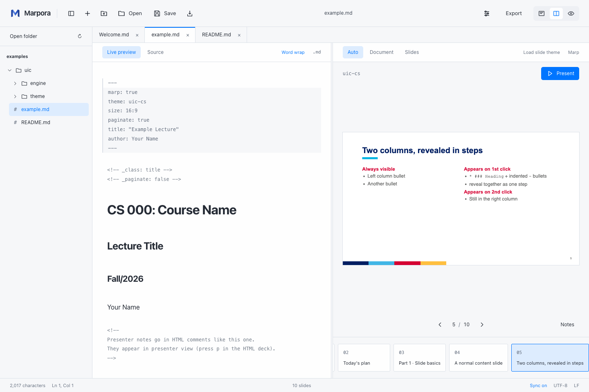
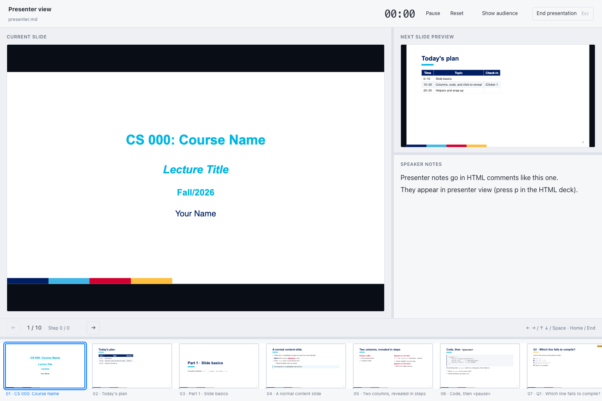

# Marpora

**本地写作，自由呈现。** 一个轻量的 Markdown 与 Marp 桌面编辑器，macOS 优先，使用 Tauri 2、Svelte 5、TypeScript、CodeMirror 6 和 Marp Core。

[下载 macOS 安装包](https://github.com/marpora/marpora/releases/latest) · [English](README.md) · [品牌文件](brand/README.md) · [实现说明](docs/architecture.md)



## 当前功能

- 原位编辑：标题、强调、链接、列表与引用即时排版；表格、代码、图片点击后编辑原始源码。可随时切换源码，保留选区与撤销记录。
- 文件夹侧栏：按需展开目录，查看 Markdown、HTML、PDF 文件，点击打开。多个标签分别保留内容、光标、滚动位置与撤销记录。
- 离线模板库：Orbit 发布会、Chalk 讲课、Thesis 学术、Brief 商务四套原创模板，每套七页及备注。支持搜索、逐页预览、新建文稿、可撤销换主题、主题包导入导出与本机持久保存。
- 基础双屏 Presenter：选择投影屏幕后，观众窗口全屏展示；主窗口显示当前页、下一页、私密备注、可暂停/重置的计时器和缩略图导航。两个窗口双向同步翻页与 fragment。
- Marp 实时幻灯片：自动识别 `marp: true`，支持分页、导航、演讲者备注、fragment、自定义主题和本地 KaTeX 字体。
- 打开已有 HTML / PDF：Marp HTML 按幻灯片显示，普通 HTML 按文档显示；PDF 支持翻页和缩放。二者均为只读预览。
- 导出独立 HTML / PDF：从当前文本（包括尚未保存的修改）生成副本，不改写源文件，也不会将源文档标为已保存。
- 中英文界面，默认英文；浅色、深色、默认跟随系统；强调色支持系统、蓝、青、玫瑰和琥珀色。模板本身保持原配色。
- 原生文件保存、另存为、文件/文件夹拖入、多草稿恢复、关闭确认、UTF-8 BOM 与 LF/CRLF 保留。覆盖前检查外部修改，以临时文件替换完成保存。

原始 Markdown 是唯一真源。front matter、分页、注释、自定义指令不会经过富文本 AST 或 HTML 反向序列化，因此切换标签或显示模式不会重排这些内容。

点击 **Templates（模板）** 打开主题库。创建文稿会打开新标签；应用主题仅编辑 Markdown 的 theme 字段，支持撤销。CSS 或完整 `.marpora.json` 包导入后可在本机离线使用。详见[模板指南](templates/README.md)与[主题库托管及创作者分成设计](docs/template-platform.md)。

## 双屏演示

打开 Marp Markdown 或导出的 Marp HTML，点击 **Present（演示）→ Audience display（观众屏幕）→ Start presentation（开始演示）**。选择投影屏幕即全屏展示，主窗口变为演讲者控制台；“显示观众窗口”可切到投影窗口。单屏可选择“窗口排练”，浏览器开发模式也支持独立排练窗口。

任一窗口使用方向键、Page Up/Down、空格逐步显示和翻页；Home/End 跳到首尾，Esc 结束。点击缩略图跳页并重置该页 fragment。计时器在观众窗口就绪后开始，可暂停、继续、重置。分栏、备注区域、缩略图大小可拖动调整，双击复位并在本机记住布局。

演示使用当前内容的快照，包含未保存修改；不会自动保存或改写源文档。备注仅保留在演讲者窗口，也支持提取标准 Marp HTML 的备注。关闭观众窗口会返回编辑；投影屏幕断开或配置改变后会结束本次演示，可重新选择屏幕。



## 预览与导出

应用使用系统 WebView，**不捆绑 Chromium 或 Node.js**。PDF 阅读组件按需加载，字体、CMap、解码资源保存在本机。macOS 的 Marp 幻灯片 PDF 导出使用小型 Swift 辅助程序，链接系统 WebKit 与 PDFKit，不要求安装浏览器。普通文档的 PDF 导出以及 Windows/Linux 的幻灯片 PDF 导出暂时复用标准路径中已安装的 Chrome、Edge 或 Chromium；没有安装时会明确提示。

HTML 导出嵌入图片、CSS 资源和数学字体，可离线查看，提供应用生成的键盘导航及打印样式。源文档中的脚本会被移除；HTML 预览也始终禁止执行脚本，因此第三方脚本功能不会完整复现。PDF 阅读暂为 canvas 显示，尚无文字选择和搜索。

单独打开文件时，相对资源仅能访问其目录内的文件。涉及 `../images/...` 时，请先打开项目文件夹，以该文件夹作为资源访问边界。缺少导出资源时会报错，避免生成缺图副本。远程图片或字体需要在导出时联网，嵌入成功的导出副本随后可离线使用。

工具栏中已去掉 UIC 专属按钮。通过“打开”选择 [UIC 示例](examples/uic/example.md)，与其他文档采用同样流程。十页测试模板涵盖双栏、代码、逐步显示和 iClicker 等。MIT 许可证与来源保留在 `examples/uic`，原始模板仓库未修改。应用仅执行内置已知扩展，不加载任意外部 JavaScript 引擎。

## 开发与验证

需要 Node.js 24+、Rust stable、[Tauri 平台依赖](https://v2.tauri.app/start/prerequisites/)。macOS 构建还需要 Xcode 的 Swift 编译器与 SDK。

```sh
npm ci
npm run desktop
```

浏览器模式：`npm run dev`，访问 `http://127.0.0.1:1420`。打开文件/目录使用上传，保存/HTML 导出使用下载，PDF 导出使用浏览器打印。浏览器文件夹权限只在本次会话有效；草稿恢复仅恢复文本，不恢复文件权限。

```sh
npm run check
npm test
npm run test:e2e
cargo test --manifest-path src-tauri/Cargo.toml --locked
npm run desktop:build -- --bundles app,dmg
```

macOS 浏览器测试使用已安装的 Chrome，其他环境可为开发测试运行 `npx playwright install chromium`，该测试浏览器不会打入应用。测试覆盖源码无损、组合输入事件、撤销、BOM/CRLF、模板指令、中英文、系统外观、文件树、多标签状态、HTML 嵌入资源、脚本清理和 PDF 翻页/缩放。

快捷键包括 ⌘ / Ctrl + O 打开、Shift + O 打开目录、S 保存、Shift + S 另存为、N 新建、W 关闭标签、/ 切换源码；Ctrl Tab 切换标签。点击右侧幻灯片或预览区后，方向键即可翻页；点击左侧后恢复光标移动。演示时空格逐步显示，Esc 退出。

## 当前边界

目前在 Apple Silicon macOS 本机验证；[打包工作流](.github/workflows/packages.yml) 在 main 更新、版本标签或手动运行时生成 Apple Silicon 与 Intel Mac DMG；Actions 产物保留 30 天。Windows/Linux 发行包后续启用，跨平台源码继续保留；Intel 运行效果仍需实机验证。macOS 本地包为临时签名，尚未 Developer ID 签名、公证；main 构建保留 Actions 产物；推送版本 tag 后，两种架构都验证通过才会自动发布 GitHub Release，并附上 SHA-256 校验文件。详见[发布说明](docs/releasing.md)。

尚无表格单元格富文本操作、文件关联、文件监听、模板商城或任意外部 Marp 插件。大文档性能未做基准测试，Marp 渲染仍在前端主线程。没有遥测、云同步；文档中的远程资源仍可能发起网络请求。草稿是本机恢复辅助，不代替正式保存。

应用代码继续放在 `marpora/marpora`；未来产品网站建议放 `marpora/website`，模板集合放 `marpora/themes`，不需要搬迁已有代码。详见[仓库规划](docs/github/repository-plan.md)。MIT 许可，独立项目，与 Typora 和 Marp 团队无隶属关系。
